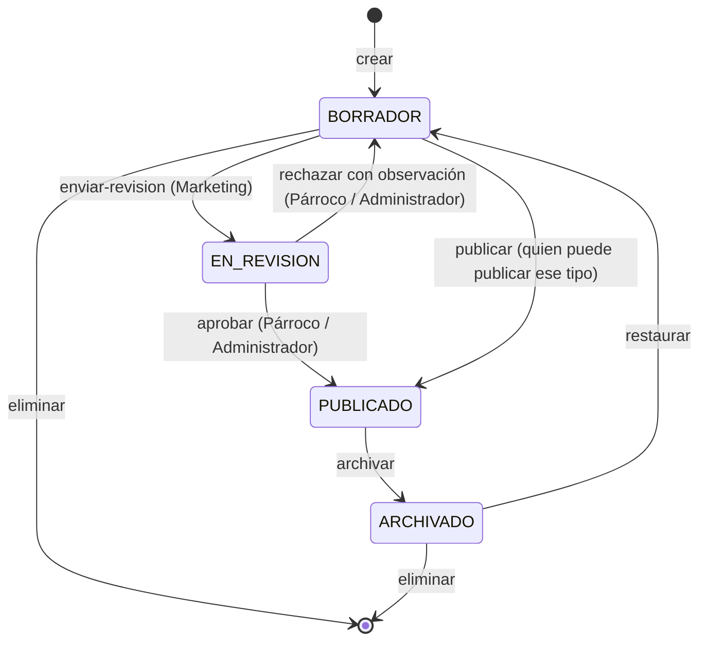

# Flujo de estados de las publicaciones

Ciclo de vida de los avisos, noticias y notas de prensa (tabla `publicacion`): quién puede mover cada publicación de un estado a otro, qué campos cambian y cómo deciden las fechas lo que se ve en el portal. Los endpoints están en [admin.md](admin.md#3-publicaciones) y los permisos en [autenticacion.md](autenticacion.md#7-matriz-de-permisos).

## 1. Estados

| Código en la API | `estado_publicacion` (id · nombre) | Significado                                                                                             |
| ---------------- | ---------------------------------- | ------------------------------------------------------------------------------------------------------- |
| `BORRADOR`       | 1 · Borrador                       | En redacción. No se ve en el portal.                                                                    |
| `EN_REVISION`    | 4 · En revisión                    | Marketing la terminó y espera la decisión del Párroco. No se puede editar ni se ve en el portal.        |
| `PUBLICADO`      | 2 · Publicado                      | Aprobada o publicada directamente. Se ve en el portal **entre** `fechaPublicacion` y `fechaExpiracion`. |
| `ARCHIVADO`      | 3 · Archivado                      | Retirada del portal y guardada como historial.                                                          |



## 2. Quién publica cada tipo

En las tablas siguientes, **«publicador del tipo»** es quien tiene el permiso de publicar ese tipo de publicación:

| Tipo                        | Publicador del tipo (permiso) | Roles                              | ¿Pasa por revisión?                                                                                                              |
| --------------------------- | ----------------------------- | ---------------------------------- | -------------------------------------------------------------------------------------------------------------------------------- |
| `AVISO`                     | `avisos.gestionar`            | Administrador, Párroco, Secretaría | No. Se publica directamente.                                                                                                     |
| `NOTICIA`, `NOTA_DE_PRENSA` | `noticias.publicar`           | Administrador, Párroco             | Solo si la redacta Marketing (`noticias.redactar` sin `noticias.publicar`). El Párroco y el Administrador publican directamente. |

## 3. Transiciones

| Acción (endpoint)             | Desde → hacia               | Quién                                                                               | Campos que cambian                                                                                                                                                           |
| ----------------------------- | --------------------------- | ----------------------------------------------------------------------------------- | ---------------------------------------------------------------------------------------------------------------------------------------------------------------------------- |
| Crear (`POST /publicaciones`) | — → `BORRADOR`              | `avisos.gestionar` para avisos; `noticias.redactar` para noticias y notas de prensa | `autor_id` = usuario de la sesión. `fecha_publicacion` guarda la fecha **deseada** (puede ser `null`).                                                                       |
| `enviar-revision`             | `BORRADOR` → `EN_REVISION`  | El **autor**, con `noticias.redactar`. Solo para `NOTICIA` y `NOTA_DE_PRENSA`.      | Solo el estado. La revisión anterior (si fue rechazada) se conserva hasta la nueva decisión.                                                                                 |
| `aprobar`                     | `EN_REVISION` → `PUBLICADO` | Publicador del tipo (`noticias.publicar`)                                           | `revisado_por` = usuario de la sesión, `fecha_revision` = ahora, `observacion_revision` = `null`, `fecha_publicacion` = [fecha efectiva](#4-fechas-programación-y-vigencia). |
| `rechazar`                    | `EN_REVISION` → `BORRADOR`  | Publicador del tipo (`noticias.publicar`)                                           | `revisado_por` = usuario de la sesión, `fecha_revision` = ahora, `observacion_revision` = la observación (obligatoria, de 5 a 500 caracteres).                               |
| `publicar`                    | `BORRADOR` → `PUBLICADO`    | Publicador del tipo                                                                 | `fecha_publicacion` = [fecha efectiva](#4-fechas-programación-y-vigencia); `fecha_expiracion` si se envía. No toca los campos de revisión.                                   |
| `archivar`                    | `PUBLICADO` → `ARCHIVADO`   | Publicador del tipo                                                                 | Solo el estado. Las fechas se conservan.                                                                                                                                     |
| `restaurar`                   | `ARCHIVADO` → `BORRADOR`    | Publicador del tipo                                                                 | Solo el estado. Para volver al portal hay que publicarla de nuevo.                                                                                                           |

Reglas generales:

- Una acción desde un estado que no le corresponde responde `409 CONFLICTO` y no cambia nada:

```json
{
  "error": {
    "codigo": "CONFLICTO",
    "mensaje": "Solo se pueden aprobar publicaciones en revisión. Esta está en «Borrador».",
    "detalles": []
  }
}
```

- `enviar-revision` sobre un `AVISO` también es `409 CONFLICTO`: los avisos no pasan por revisión.
- Quien no tiene el permiso recibe `403 SIN_PERMISO`. Por ejemplo, Marketing al intentar `publicar` o `aprobar`, o un usuario de Marketing al enviar a revisión el borrador de otro.
- Cada transición se registra en la bitácora con el estado anterior y el nuevo.
- Las transiciones son atómicas: si dos personas aprueban y rechazan a la vez, gana la primera y la segunda recibe `409 CONFLICTO`.

### Requisitos para salir de `BORRADOR`

`enviar-revision`, `aprobar` y `publicar` validan que la publicación esté completa. Si no lo está, responden `400 VALIDACION` con un detalle por cada campo que falta:

| Requisito                                                                                                                  | `campo` del detalle |
| -------------------------------------------------------------------------------------------------------------------------- | ------------------- |
| Título de 3 a 200 caracteres.                                                                                              | `titulo`            |
| `NOTICIA` y `NOTA_DE_PRENSA`: al menos un bloque de contenido **o** una `urlExterna`. Los avisos solo necesitan el título. | `contenido.bloques` |
| Si tiene imagen de portada, la imagen tiene `textoAlternativo`.                                                            | `imagenPortadaId`   |
| Si tiene `fechaExpiracion`, es posterior a la fecha efectiva de publicación y a ahora.                                     | `fechaExpiracion`   |

```json
{
  "error": {
    "codigo": "VALIDACION",
    "mensaje": "La publicación no está lista para publicarse.",
    "detalles": [
      {
        "campo": "contenido.bloques",
        "mensaje": "Agrega contenido o un enlace externo."
      },
      {
        "campo": "imagenPortadaId",
        "mensaje": "La imagen de portada necesita un texto alternativo."
      }
    ]
  }
}
```

## 4. Fechas: programación y vigencia

### Fecha efectiva de publicación

Al **aprobar** o **publicar**, `fecha_publicacion` se calcula así:

1. Se toma la `fechaPublicacion` del cuerpo de la acción; si no viene, la fecha deseada que ya estaba guardada; si tampoco hay, **ahora**.
2. Si esa fecha ya pasó, se usa **ahora**. Así una publicación nunca aparece con una fecha anterior a cuando realmente salió.

Si la fecha resultante es futura, la publicación queda **programada**: está en `PUBLICADO`, pero el portal no la muestra hasta esa fecha. No hace falta ningún proceso programado: el filtro del portal compara con la hora actual en cada consulta, y la caché se invalida al vencer la próxima fecha programada.

### Vigencia

El portal muestra una publicación solo si:

```text
estado = PUBLICADO  y  fecha_publicacion <= ahora  y  (fecha_expiracion es null  o  fecha_expiracion > ahora)
```

Al llegar `fechaExpiracion`, la publicación **sigue en `PUBLICADO`** pero desaparece del portal. No se archiva sola: para quitarla del listado del panel se archiva a mano.

### Situación que muestra el panel

El panel no recibe un estado extra, pero puede mostrar la situación real a partir de `estado`, las fechas y `visibleEnPortal` ([admin.md](admin.md#objeto-publicación-vista-del-panel)):

| Situación (etiqueta del panel) | Condición                                                      |
| ------------------------------ | -------------------------------------------------------------- |
| Borrador                       | `estado = BORRADOR` y `revision` es `null` o sin `observacion` |
| Rechazada (con observación)    | `estado = BORRADOR` y `revision.observacion` tiene valor       |
| En revisión                    | `estado = EN_REVISION`                                         |
| Programada                     | `estado = PUBLICADO` y `fechaPublicacion` > ahora              |
| Publicada                      | `visibleEnPortal = true`                                       |
| Expirada                       | `estado = PUBLICADO` y `fechaExpiracion` ≤ ahora               |
| Archivada                      | `estado = ARCHIVADO`                                           |

## 5. Edición según el estado

`PATCH /api/admin/publicaciones/:id` está permitido o no según el estado y el rol. Si no lo está, responde `409 CONFLICTO` (por el estado) o `403 SIN_PERMISO` (por el rol).

| Estado        | Quién puede editar                                                   | Notas                                                                                                                         |
| ------------- | -------------------------------------------------------------------- | ----------------------------------------------------------------------------------------------------------------------------- |
| `BORRADOR`    | El autor (con el permiso de crear ese tipo) y el publicador del tipo | Marketing solo edita sus propios borradores. Después de un rechazo, corrige y vuelve a enviar a revisión.                     |
| `EN_REVISION` | Solo el publicador del tipo                                          | Marketing no puede editarla mientras espera. El Párroco puede corregir detalles antes de aprobar; editar no cambia el estado. |
| `PUBLICADO`   | Solo el publicador del tipo                                          | Los cambios se ven de inmediato en el portal. El `slug` ya no se puede cambiar, para no romper los enlaces compartidos.       |
| `ARCHIVADO`   | Nadie                                                                | Primero hay que restaurarla (`restaurar` → `BORRADOR`).                                                                       |

El `tipo` de una publicación no se puede cambiar en ningún estado.

## 6. Eliminación

`DELETE /api/admin/publicaciones/:id` borra la publicación definitivamente.

| Estado                     | Quién puede eliminar                                                                       |
| -------------------------- | ------------------------------------------------------------------------------------------ |
| `BORRADOR`                 | El autor y el publicador del tipo                                                          |
| `ARCHIVADO`                | El publicador del tipo                                                                     |
| `EN_REVISION`, `PUBLICADO` | Nadie, tampoco el Administrador: `409 CONFLICTO`. Primero hay que rechazarla o archivarla. |

## 7. Ejemplo completo: noticia redactada por Marketing

Campos relevantes de la respuesta en cada paso, para la publicación 7 («Solemnidad de Cristo Rey: invitación a la procesión»).

**1. Marketing la crea** (`POST /api/admin/publicaciones`, con fecha deseada 15/11 a las 08:00):

```json
{
  "id": 7,
  "estado": { "codigo": "BORRADOR", "nombre": "Borrador" },
  "autor": { "id": 4, "nombreCompleto": "Marketing (desarrollo)" },
  "fechaPublicacion": "2026-11-15T08:00:00-04:00",
  "revision": null,
  "visibleEnPortal": false,
  "acciones": ["EDITAR", "ELIMINAR", "ENVIAR_REVISION"]
}
```

**2. Marketing la envía a revisión** (`POST /api/admin/publicaciones/7/enviar-revision`). Desde la sesión de Marketing ya no hay acciones disponibles:

```json
{
  "id": 7,
  "estado": { "codigo": "EN_REVISION", "nombre": "En revisión" },
  "revision": null,
  "visibleEnPortal": false,
  "acciones": []
}
```

**3. El Párroco la rechaza** (`POST /api/admin/publicaciones/7/rechazar`):

```json
{
  "id": 7,
  "estado": { "codigo": "BORRADOR", "nombre": "Borrador" },
  "revision": {
    "revisadoPor": { "id": 2, "nombreCompleto": "Párroco (desarrollo)" },
    "fecha": "2026-11-12T17:40:02-04:00",
    "observacion": "Corregir la hora de la procesión: es a las 11:30, después de la misa."
  },
  "visibleEnPortal": false,
  "acciones": ["EDITAR", "ELIMINAR", "PUBLICAR"]
}
```

(Las `acciones` son las de la sesión del Párroco. Marketing vería `["EDITAR", "ELIMINAR", "ENVIAR_REVISION"]`.)

**4. Marketing corrige y la vuelve a enviar.** **5. El Párroco la aprueba** (`POST /api/admin/publicaciones/7/aprobar`, sin cuerpo). La fecha deseada (15/11) es futura, así que queda programada:

```json
{
  "id": 7,
  "estado": { "codigo": "PUBLICADO", "nombre": "Publicado" },
  "fechaPublicacion": "2026-11-15T08:00:00-04:00",
  "fechaExpiracion": "2026-11-23T00:00:00-04:00",
  "revision": {
    "revisadoPor": { "id": 2, "nombreCompleto": "Párroco (desarrollo)" },
    "fecha": "2026-11-12T18:02:11-04:00",
    "observacion": null
  },
  "visibleEnPortal": false,
  "acciones": ["EDITAR", "ARCHIVAR"]
}
```

El 15/11 a las 08:00 aparece en el portal (`visibleEnPortal: true`). El 23/11 a las 00:00 deja de aparecer, porque expira. Después, el Párroco o el Administrador pueden archivarla.

### Aviso de Secretaría (sin revisión)

Secretaría crea el aviso y lo publica de inmediato. Son dos llamadas que el panel puede hacer con un solo botón «Publicar» (RNF-04: publicar en como máximo 3 pasos):

1. `POST /api/admin/publicaciones` con `"tipo": "AVISO"` → `BORRADOR`.
2. `POST /api/admin/publicaciones/:id/publicar` → `PUBLICADO`, visible desde ahora.

## 8. Otros recursos con estado

Eventos y páginas también usan `estado_publicacion`, pero sin revisión ni programación:

| Recurso | Estados permitidos                   | Cómo se cambia                     | Visible en el portal si…         |
| ------- | ------------------------------------ | ---------------------------------- | -------------------------------- |
| Evento  | `BORRADOR`, `PUBLICADO`, `ARCHIVADO` | Campo `estado` en `POST` y `PATCH` | `PUBLICADO` y no terminó (RF-09) |
| Página  | `BORRADOR`, `PUBLICADO`, `ARCHIVADO` | Campo `estado` en `POST` y `PATCH` | `PUBLICADO`                      |

`EN_REVISION` en un evento o una página es `400 VALIDACION`.
