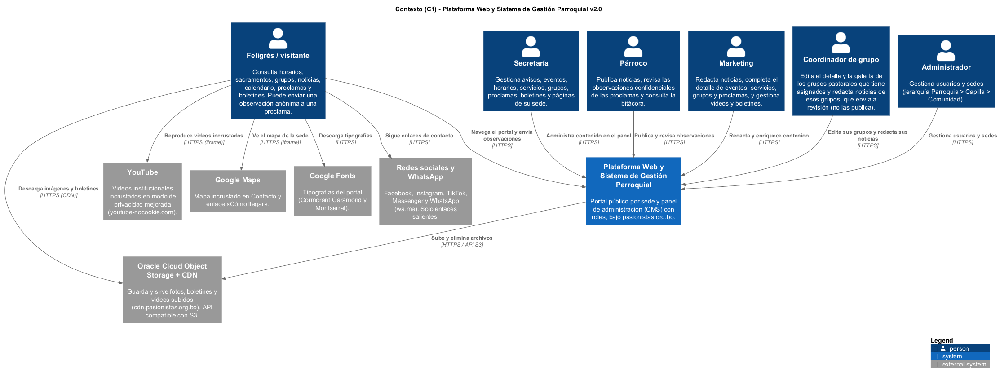
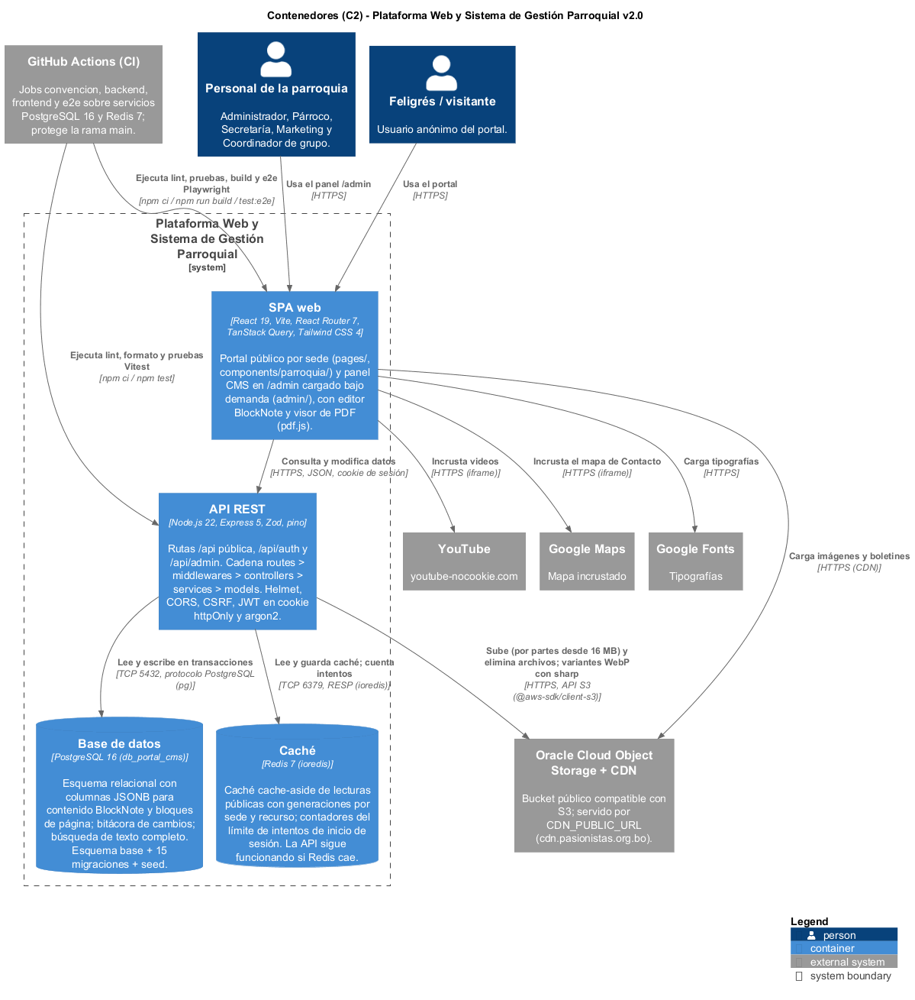
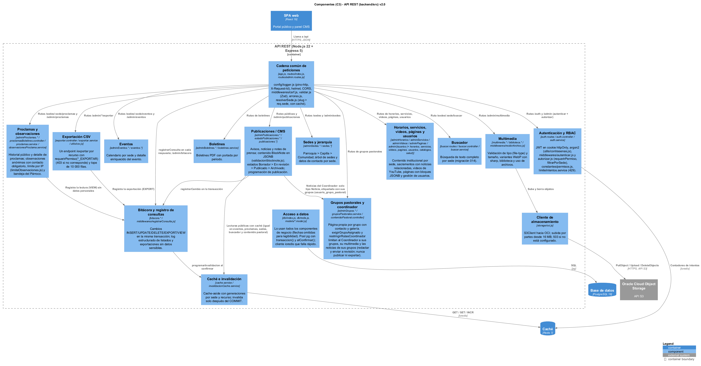
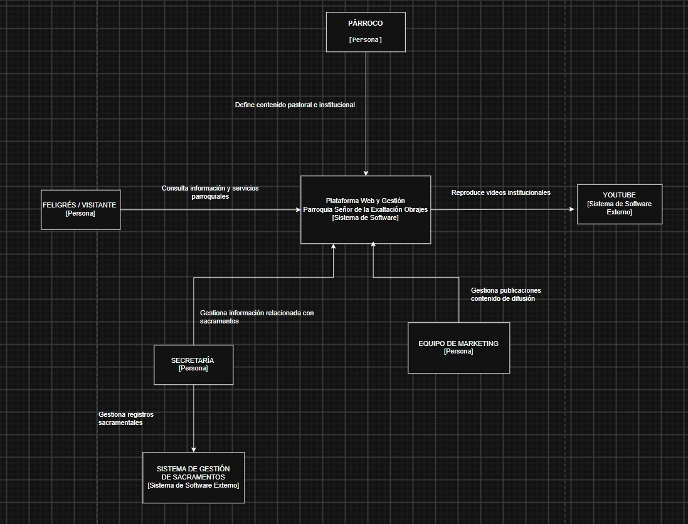
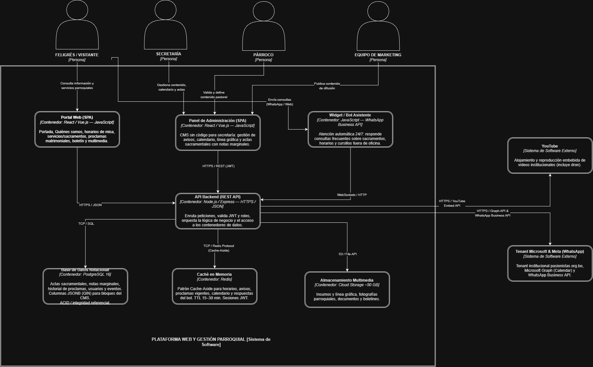
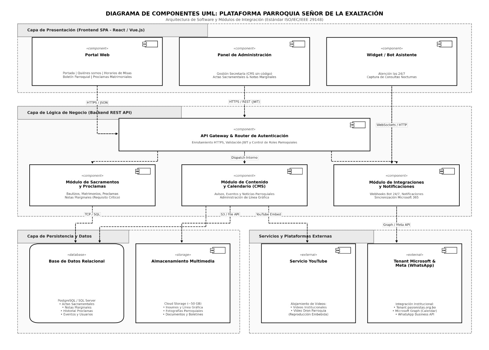

# Documento 3: Arquitectura de Software - Modelo C4

Este documento presenta la arquitectura del sistema aplicando el enfoque de zoom de Simon Brown (Niveles 1 al 3).

| Versión | Fecha | Estado | Descripción |
|---|---|---|---|
| v1 | Septiembre 2026 | Histórica | Arquitectura propuesta antes de construir el sistema (diagramas en draw.io). |
| v2 | Noviembre 2026 | Vigente | Arquitectura realmente implementada en la versión 2.0, derivada del código del repositorio. Historia Jira PAR-243. |

---

## Versión 2 (vigente): arquitectura implementada en la v2.0

Los diagramas están escritos como código en notación [C4-PlantUML](https://github.com/plantuml-stdlib/C4-PlantUML). Las fuentes están en `modelos/c4/v2/` y las imágenes exportadas en `docs/arquitectura/v2/` y `modelos/c4/v2/`.

Para regenerar las imágenes (requiere Java; no requiere Graphviz porque los diagramas usan el motor de diseño `smetana`):

```bash
java -jar plantuml.jar -charset UTF-8 -tpng modelos/c4/v2/*.puml
```

### C1 - Diagrama de contexto

Personas: feligrés o visitante, Secretaría, Párroco, Marketing, Coordinador de grupo y Administrador (los roles de `backend/src/constantes/catalogos.js`). Sistemas externos que el código usa de verdad: Oracle Cloud Object Storage con su CDN, YouTube, Google Maps, Google Fonts y los enlaces a redes sociales y WhatsApp.

Fuente: [`modelos/c4/v2/C1-contexto.puml`](../../modelos/c4/v2/C1-contexto.puml)



### C2 - Diagrama de contenedores

Una SPA React (portal público y panel CMS en `/admin`), la API REST en Node.js y Express, PostgreSQL 16, Redis 7 y Oracle Cloud Object Storage, con GitHub Actions como integración continua. `docker-compose.yml` levanta solo PostgreSQL y Redis para desarrollo.

Fuente: [`modelos/c4/v2/C2-contenedores.puml`](../../modelos/c4/v2/C2-contenedores.puml)



### C3 - Diagrama de componentes del backend

Zoom al contenedor API REST (`backend/src`). Cada componente agrupa sus archivos reales de `routes/`, `controllers/`, `services/`, `middlewares/` y `models/`.

Fuente: [`modelos/c4/v2/C3-componentes-backend.puml`](../../modelos/c4/v2/C3-componentes-backend.puml)



---

## Registro de cambios v1 → v2

La v1 se diseñó en septiembre, a partir del relevamiento y antes de escribir código. La v2 se deriva del sistema construido en los Sprints 1 a 3. Los cambios responden a tres causas: funcionalidades pospuestas fuera de la v2.0, decisiones tomadas durante la construcción y correcciones de la parroquia y del docente en el Sprint 3.

### Qué se quitó

| Elemento de la v1 | Nivel | Por qué se quitó |
|---|---|---|
| Widget / Bot Asistente 24/7 (WhatsApp Business API) y captura de consultas nocturnas | C2, C3 | Pospuesto fuera de la v2.0 (RF-07 y RF-08): no está implementado. |
| Tenant Microsoft & Meta (Microsoft Graph Calendar, WhatsApp Business API) | C2, C3 | Pospuesto fuera de la v2.0 (RF-10 y RF-12): no hay integración en el código. |
| Módulo de Integraciones y Notificaciones | C3 | Solo existía para el bot y Microsoft 365; sin esas integraciones no tiene función. |
| Sistema de Gestión de Sacramentos (externo) y Módulo de Sacramentos con notas marginales y actas sacramentales | C1, C2, C3 | Pospuesto fuera de la v2.0 (RF-03). Los «servicios» del portal muestran información de los sacramentos, pero no hay registros sacramentales ni notas marginales. |
| Contenedores separados «Portal Web (SPA)» y «Panel de Administración (SPA)» | C2 | Se construyó una sola SPA: el panel es una ruta (`/admin`) que se descarga bajo demanda. |
| «API Gateway & Router de Autenticación» como componente único | C3 | No hay un gateway: la autenticación y la autorización son middlewares de Express (`autenticar.js`, `autorizar.js`) aplicados por ruta. |
| Sesiones JWT guardadas en Redis | C2 | El JWT viaja en una cookie httpOnly; la API verifica su firma y comprueba en PostgreSQL que el usuario siga activo (`auth.service.js`, `autenticarToken`). Redis guarda la caché y los contadores del límite de intentos, no sesiones. |
| Comunicación por WebSockets | C2, C3 | No existe; toda la comunicación es HTTPS y JSON. |

### Qué se corrigió

| v1 | v2 | Motivo |
|---|---|---|
| «React / Vue.js» | React 19 con Vite, React Router y TanStack Query | El equipo construyó solo con React. |
| «Cloud Storage ~50 GB» | Oracle Cloud Object Storage (API S3) servido por un CDN (`cdn.pasionistas.org.bo`) | Es el proveedor elegido; las variables `OCI_S3_*` y `CDN_PUBLIC_URL` están en `backend/src/config/entorno.js`. |
| «PostgreSQL / SQL Server» (C3) | PostgreSQL 16 | Decisión del ADR-01; no se usa SQL Server. |
| Redis sin versión | Redis 7, cache-aside con generaciones por sede y recurso e invalidación después del COMMIT | Implementación real de `cache.service.js` e `invalidacionCache.service.js` (ADR-02). |
| El sistema hace llamadas a la API de YouTube | El navegador incrusta los videos con `youtube-nocookie.com` | El backend solo guarda el identificador del video; no llama a ninguna API de YouTube. |

### Qué se agregó

| Elemento nuevo | Nivel | Por qué |
|---|---|---|
| Roles Coordinador de grupo y Administrador | C1, C3 | El Coordinador lo pidieron los ingenieros de la parroquia (Sprint 3): edita sus grupos pastorales y redacta noticias de esos grupos, que envía a revisión (PR #74). El Administrador gestiona usuarios y sedes. |
| Google Maps y Google Fonts | C1, C2 | Los usa el portal: mapa incrustado en Contacto y tipografías institucionales. |
| Redes sociales y WhatsApp como enlaces salientes | C1 | Reemplazan la integración con Meta: son enlaces directos, sin API. |
| GitHub Actions (CI) | C2 | Jobs `convencion`, `backend`, `frontend` y `e2e` que protegen `main` (observación del docente). |
| Cadena común de peticiones (helmet, CORS, CSRF, Zod, pino, `resolverSede`) | C3 | Seguridad y validación transversales de la API. |
| Componentes por módulo: publicaciones con estados, eventos con detalle, proclamas y observaciones, boletines, multimedia, sedes con jerarquía, grupos pastorales y coordinador, horarios, servicios, videos, páginas y usuarios | C3 | El «Módulo de Contenido y Calendario» de la v1 se dividió en los módulos que el sistema tiene de verdad. |
| Buscador global de texto completo | C3 | Pedido por marketing (Sprint 3). |
| Exportación CSV con permiso por rol | C3 | Observación del docente (Sprint 3). |
| Bitácora de cambios y registro de consultas | C3 | Auditoría de cambios y registro estructurado de listados y exportaciones sin datos sensibles (observación del docente). |
| Cliente de almacenamiento (`storage/oci.js`) y procesamiento de imágenes (sharp, WebP) | C3 | Subida por partes y variantes optimizadas para el portal. |

---

## Versión 1 (histórica): arquitectura propuesta en septiembre de 2026

Se conserva como registro de la propuesta inicial. **No refleja el sistema implementado**; ver la versión 2.

### C1 - Diagrama de Contexto
Delimitación de frontera del sistema, personas/actores principales y sistemas externos.



### C2 - Diagrama de Contenedores
Descomposición en bloques ejecutables especificando tecnologías y protocolos.



### C3 - Diagrama de Componentes
Zoom al contenedor Backend desglosando Controllers, Services, Repositories, etc.


